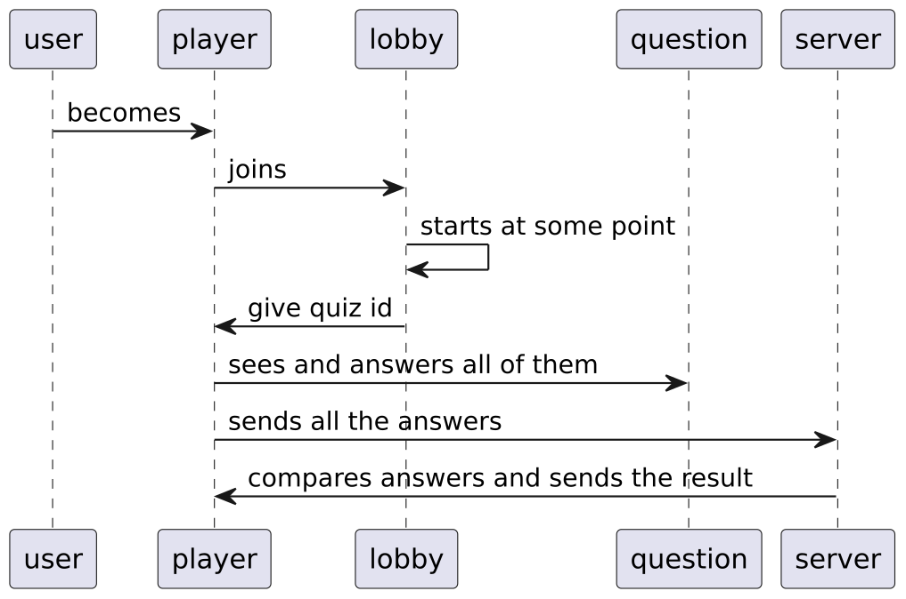

# Zkahoot

## Это ветка `dev`.

Суть данной ветки в том, что она не `master`. Круто. Еее.

## UML диаграмма

Следующим образом выглядит UML-диграмма



## Стурктура

Следующим образом выглядит стурктура проекта.

```
.
|-- README.md
|-- classes
|   |-- API.py
|   |-- Answer.py
|   |-- DBWrapper.py
|   |-- Lobby.py
|   |-- Player.py
|   |-- Question.py
|   |-- Quiz.py
|   `-- User.py
|-- media
|   `-- uml.png
|-- requirements.txt
|-- scheme.sql
`-- tests
```
